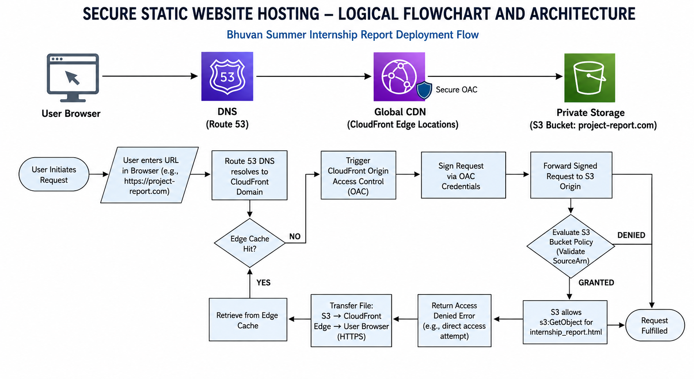
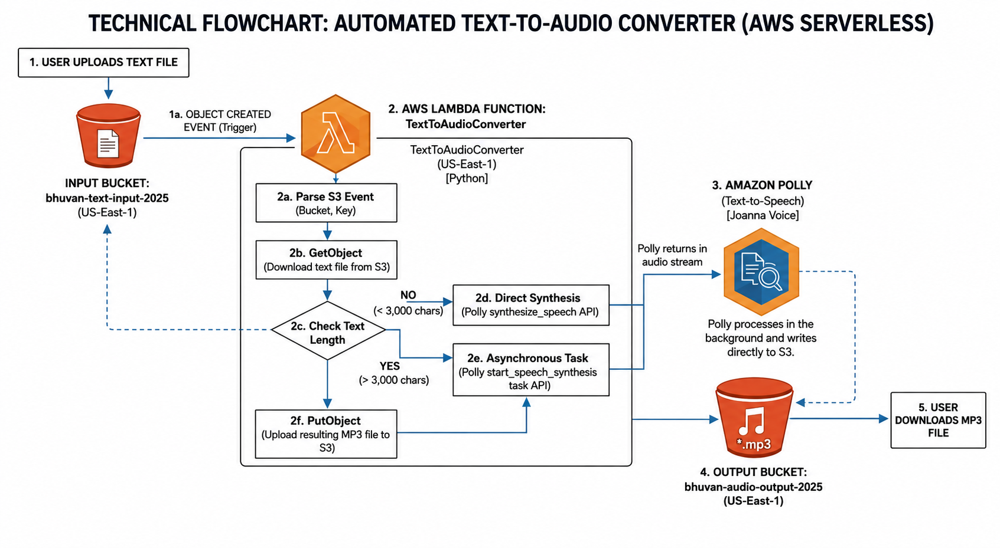
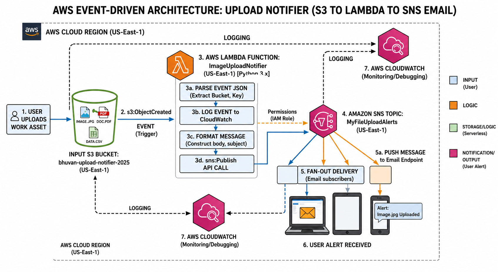
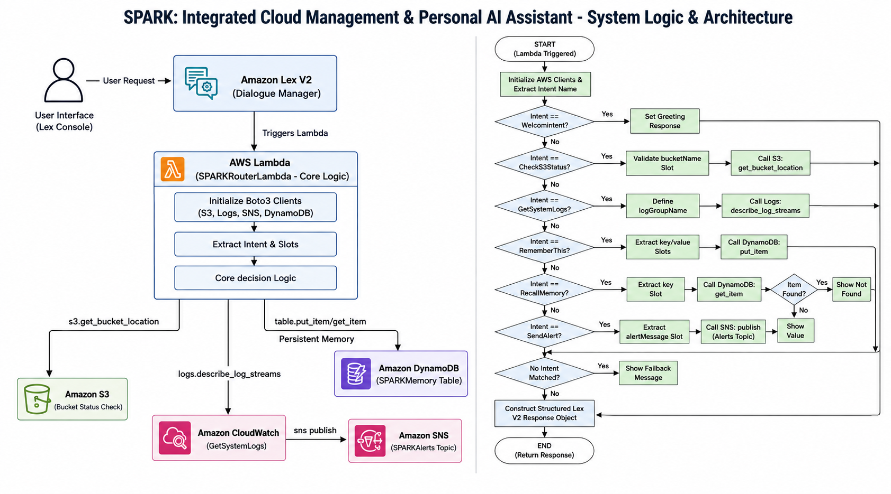

<div align="center">

# ⚡ Event-Driven Programs Using Serverless Architecture in Cloud
### Summer Internship — Tata Steel, SNTI Jamshedpur (June 2025)


📄 **[Read the Full Internship Report](https://drive.google.com/file/d/1hZjngzBuRiI6bFhFzB0viwR1xHfcIrKo/view?usp=sharing)**

</div>

---

### // overview

> Four projects. One month. Zero servers managed.

A one-month Summer Internship at **Tata Steel — Steel Networking & Training Institute (SNTI), Jamshedpur**, under mentor Prem Chand Kodem. The internship progressively built four serverless AWS projects — three minor, one major — culminating in **SPARK**, a conversational AI assistant that executes real cloud operations through natural language.

<br>

### // project portfolio

| # | Project | Type | AWS Services |
|---|---|---|---|
| 1 | Secure Static Website Hosting & Global Content Delivery | Minor | S3 · CloudFront (OAC) · Route 53 |
| 2 | Automated Text-to-Audio Converter | Minor | S3 · Lambda · Amazon Polly · CloudWatch |
| 3 | Upload Notifier — Event-Driven Alert System | Minor | S3 · Lambda · Amazon SNS · CloudWatch |
| 4 | **SPARK Personal AI Assistant** | Major | Lex V2 · Lambda · DynamoDB · SNS · S3 · CloudWatch |

<br>

---

## // project 1 — secure static website hosting



A private-origin static site: S3 storage locked behind **Origin Access Control (OAC)**, fronted by CloudFront for global edge caching, resolved via Route 53. Zero direct public access to the bucket — every request is signed and validated against the CloudFront distribution ARN.

**Request Lifecycle:**
```
> user requests URL        → Route 53 resolves to CloudFront
> edge cache hit?          → YES: serve immediately over HTTPS
> edge cache miss          → CloudFront signs request via OAC
> S3 validates SourceArn   → GRANTED: serve + cache | DENIED: Access Denied error
```

**[View the bucket policy →](./01-bucket-policy.json)**

**Key outcomes:** zero-server overhead · defence-in-depth security via private origin · near-instant global load times · $0/month base cost (pay-as-you-go)

<br>

---

## // project 2 — automated text-to-audio converter



An event-driven pipeline: upload a `.txt` file to S3, and a Lambda function automatically converts it to speech via **Amazon Polly's neural voice engine**, storing the resulting MP3 back in S3 for download.

**[View the full Lambda code →](./02-TextToAudioConverter.py)**

**Processing algorithm:**
```
> upload .txt to input bucket        → s3:ObjectCreated event fires
> Lambda parses event, reads text    → via s3.get_object()
> text < 3,000 chars                 → polly.synthesize_speech() (direct)
> text > 3,000 chars                 → polly.start_speech_synthesis_task() (async)
> MP3 written to output bucket       → via s3.put_object()
> user downloads finished audio file
```

**Result:** `Script-1.txt` (25.4 KB) → `Script-1.mp3` (9.9 MB) · Lambda: 1,114ms duration, 97MB/128MB memory

**Challenge solved:** Polly's direct synthesis has a character limit — resolved by branching to the async `start_speech_synthesis_task()` API for longer text, identified via CloudWatch log analysis.

<br>

---

## // project 3 — upload notifier (event-driven alerts)



A zero-latency notification system: any file uploaded to a monitored S3 bucket instantly triggers a formatted email alert via SNS — eliminating manual upload monitoring entirely.

**[View the full Lambda code →](./03-ImageUploadNotifier.py)**

**Three-layer architecture:**
```
> Storage Layer      → S3 fires s3:ObjectCreated:* on every upload
> Compute Layer      → Lambda parses event, formats alert message
> Messaging Layer    → SNS fans out email delivery to subscribers
```

**Challenges solved:**
- `InvalidClientTokenId` error from cross-region service mismatch → resolved by aligning all services in `eu-north-1`
- SNS subscription confirmation blocked by spam filters → resolved via manual token confirmation

**Proof of success:** live email received — *"Bhuvan, a new file has been detected..."* · CloudWatch confirmed successful publish with MessageId tracking

<br>

---

## // project 4 — SPARK personal AI assistant (major project)



The capstone project — a conversational AI assistant bridging natural language with real AWS operations. Built on **Amazon Lex V2** for dialogue management, with a central Lambda router dispatching to S3, CloudWatch, DynamoDB, and SNS based on detected intent.

**[View the full Lambda code →](./04-SPARKRouterLambda.py)**

**Seven intents, seven backend actions:**

| Intent | Sample Utterance | Backend Action |
|---|---|---|
| `WelcomeIntent` | "Hello / Hi SPARK" | Returns system readiness greeting |
| `CheckS3Status` | "Check bucket my-bucket" | `s3.get_bucket_location()` health probe |
| `GetSystemLogs` | "Show me the system logs" | `logs.describe_log_streams()` via CloudWatch |
| `RememberThis` | "Remember that project = SPARK" | `table.put_item()` — DynamoDB write |
| `RecallMemory` | "What is project?" | `table.get_item()` — DynamoDB read |
| `SendAlert` | "Send alert: Server is down" | `sns.publish()` to SPARKAlerts topic |
| `FallbackIntent` | (unrecognised input) | Default fallback message |

**Logic flow:**
```
> Lex V2 receives input          → invokes SPARKRouterLambda with session JSON
> Lambda extracts intent + slots → routes to matching AWS service via boto3
> Response constructed           → dialogAction: Close, intent state: Fulfilled
> Returned to Lex V2             → displayed to user
```

**Key achievements:**
- ✅ Bot successfully built — 7 intents, English (US), ready for full testing
- ✅ Cross-session memory via DynamoDB `SPARKMemory` (On-Demand capacity, Active)
- ✅ Live SNS email notifications triggered purely via conversation
- ✅ Lambda metrics: 2 invocations · 318.9ms avg duration · 100% success rate

<br>

---

### // skills exercised

`AWS Lambda` `Amazon S3` `CloudFront (OAC)` `Route 53` `Amazon Polly` `Amazon Lex V2` `DynamoDB` `Amazon SNS` `CloudWatch` `IAM Roles & Bucket Policies` `Python 3.12 (boto3 SDK)` `Event-Driven Architecture` `Decoupled Microservices`

<br>

### // outcomes

- ✅ Four fully deployed, tested serverless projects across distinct AWS problem domains
- ✅ Hands-on experience with 7+ AWS services in real, working pipelines
- ✅ Real-world debugging: character limit overflow, cross-region token errors, SNS spam-filter blocking — each diagnosed via CloudWatch and resolved
- ✅ SPARK demonstrates end-to-end conversational AI wired directly into live cloud infrastructure — not a demo, an operational assistant

<br>

---

<div align="center">

**Polikey Bhuvan** — B.Tech CSE, Centurion University of Technology & Management
Summer Internship @ Tata Steel, SNTI Jamshedpur · Mentor: Prem Chand Kodem

[Portfolio](https://polikey-bhuvan.onrender.com) · [LinkedIn](https://linkedin.com/in/polikeybhuvan) · [GitHub](https://github.com/polikeybhuvan)

</div>4
