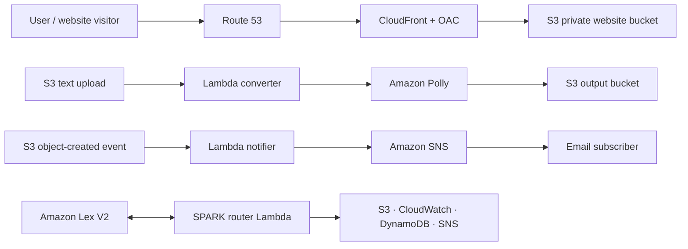

<div align="center">

# ⚡ Serverless Architecture in the Cloud

### Tata Steel · Summer Internship · SNTI Jamshedpur · June 2025

**Four AWS projects exploring secure hosting, event-driven automation, notifications, and conversational cloud operations.**

<p>
  
  
  
  
</p>

[📄 Internship report](https://drive.google.com/file/d/1hZjngzBuRiI6bFhFzB0viwR1xHfcIrKo/view?usp=sharing) · [GitHub repository](https://github.com/polikeybhuvan/tata-steel-serverless-internship) · [Report an issue](https://github.com/polikeybhuvan/tata-steel-serverless-internship/issues/new)

</div>

---

## Overview

During my summer internship at **Tata Steel's Steel Networking & Training Institute (SNTI), Jamshedpur**, I explored how AWS managed services can solve practical cloud problems without managing traditional servers.

The portfolio contains **three focused serverless projects and one capstone, SPARK**. It moves from secure static website delivery, to event-triggered processing and alerts, and finally to a conversational interface for selected AWS operations.

> This repository documents internship work and includes example Lambda handlers, an S3 bucket-policy template, and architecture diagrams. It is not a one-click deployment package: AWS resources, event triggers, IAM roles, environment variables, and service permissions must be configured in your own account.

## Project portfolio

| # | Project | Main idea | AWS services |
|---|---|---|---|
| 01 | [Secure static website hosting](#1-secure-static-website-hosting) | Serve a private S3 origin through a CDN | S3, CloudFront OAC, Route 53 |
| 02 | [Text-to-audio converter](#2-event-driven-text-to-audio) | Turn uploaded text into MP3 audio | S3, Lambda, Amazon Polly, CloudWatch |
| 03 | [Upload notifier](#3-event-driven-upload-notifier) | Notify subscribers when an object is uploaded | S3, Lambda, Amazon SNS, CloudWatch |
| 04 | [SPARK personal assistant](#4-spark-personal-ai-assistant) | Route conversational intents to selected AWS actions | Amazon Lex V2, Lambda, DynamoDB, SNS, S3, CloudWatch |

## Architecture at a glance



## 1. Secure static website hosting


**Goal:** deliver a static website using CloudFront while keeping the S3 origin private.

1. Route 53 resolves the website name to the CloudFront distribution.
2. CloudFront serves cache hits from edge locations.
3. On a cache miss, CloudFront accesses S3 using **Origin Access Control (OAC)**.
4. The bucket policy permits object reads only from the specified CloudFront distribution.

The policy template is available at [`01-bucket-policy.json`](./01-bucket-policy.json).

**Before using the policy:** replace `YOUR_BUCKET_NAME`, `YOUR_ACCOUNT_ID`, and `YOUR_DISTRIBUTION_ID` with values from your own AWS environment. The policy is not deployable with those placeholders unchanged. Configure TLS, DNS records, the CloudFront distribution, and S3 content as separate resources.

**Cloud concepts:** private origins, least-privilege resource policies, CDN caching, DNS, and HTTPS delivery.

## 2. Event-driven text-to-audio


**Goal:** convert an S3 text upload to MP3 audio using Amazon Polly.

The handler in [`02-TextToAudioConverter.py`](./02-TextToAudioConverter.py) follows this flow:

1. An S3 object-created event identifies the uploaded object.
2. The handler decodes the URL-encoded key and reads UTF-8 text.
3. Inputs up to 3,000 characters use synchronous Polly synthesis.
4. Longer inputs use an asynchronous synthesis task, which writes output to S3.
5. The response reports the MP3 key for synchronous work, or the task ID and output prefix for asynchronous work.

Amazon Polly documents a 3,000 billed-character limit for synchronous synthesis and up to 100,000 billed characters for asynchronous synthesis, subject to service quotas and supported voice/engine settings. See the [official Polly limits](https://docs.aws.amazon.com/polly/latest/dg/limits.html) and [asynchronous synthesis guide](https://docs.aws.amazon.com/polly/latest/dg/asynchronous.html).

**Configuration:** set `OUTPUT_BUCKET` in the Lambda environment. `OUTPUT_PREFIX` is optional; `POLLY_VOICE_ID` defaults to `Joanna`, and `POLLY_ENGINE` defaults to `standard`.

**Important:** Polly asynchronous output is task-based. For long inputs, audio is written under the returned output prefix using a task-generated filename; the handler does not wait until the MP3 is ready.

The internship notes recorded a historical example of a 25.4 KB text file producing a 9.9 MB MP3. This remains a historical observation, not a benchmark rerun against the updated code.

## 3. Event-driven upload notifier


**Goal:** send a notification when an object is created in a monitored S3 bucket.

The handler in [`03-ImageUploadNotifier.py`](./03-ImageUploadNotifier.py):

1. Accepts one or more S3 event records.
2. Decodes the object key so spaces and encoded characters are handled correctly.
3. Publishes a concise notification through a configured SNS topic.
4. Returns SNS message IDs to help with troubleshooting.

Set `SNS_TOPIC_ARN` in the Lambda environment. Configure an S3 event notification, an SNS topic and subscription, and a Lambda execution role that allows publishing to that topic.

**Troubleshooting lessons recorded during the internship:**
- Check that clients, topic ARNs, and resources use compatible AWS Regions.
- Confirm the SNS email subscription using its confirmation message.
- Use CloudWatch logs and SNS message IDs to trace failures.

## 4. SPARK personal AI assistant


**Goal:** connect natural-language intents in Amazon Lex V2 to selected AWS operations through a Lambda router.

The router is in [`04-SPARKRouterLambda.py`](./04-SPARKRouterLambda.py).

| Intent | Example request | Current handler behavior |
|---|---|---|
| `WelcomeIntent` | “Hi SPARK” | Returns a greeting |
| `CheckS3Status` | “Check bucket my-bucket” | Calls `GetBucketLocation` as an access check |
| `GetSystemLogs` | “Show me the system logs” | Reads recent events from the configured CloudWatch log stream |
| `RememberThis` | “Remember project = SPARK” | Writes a key/value item to DynamoDB |
| `RecallMemory` | “What is project?” | Reads a saved DynamoDB item |
| `SendAlert` | “Send alert: Server is down” | Publishes a message to SNS |
| `FallbackIntent` | An unrecognised request | Returns a fallback response |

### SPARK configuration

| Variable | Purpose | Default |
|---|---|---|
| `SPARK_MEMORY_TABLE` | DynamoDB table | `SPARKMemory` |
| `SPARK_LOG_GROUP` | CloudWatch log group | `/aws/lambda/SPARKRouterLambda` |
| `SPARK_ALERTS_TOPIC_ARN` | SNS topic for alerts | Required for `SendAlert` |
| `SPARK_DEFAULT_USER_ID` | Fallback key for demo memory | `Bhuvan` |
| `AWS_REGION` | Region for AWS clients | Lambda region, or `us-east-1` fallback |

SPARK expects Lex V2 session attributes to supply a `userId` when memory should be separated by user. The fallback ID is for a single-user demonstration only; **do not use a caller-controlled session attribute as an identity boundary in a multi-user system**. Derive identity from a trusted authentication layer and apply least-privilege IAM policies.

The handler now returns a generic failure message and marks the Lex intent as `Failed` when an AWS action fails, while logging diagnostic detail to CloudWatch. This avoids returning raw SDK exceptions to the user.

## What I learned

- **Secure by design:** a public website does not require a public S3 bucket when CloudFront OAC is configured correctly.
- **Use the right processing model:** synchronous Polly synthesis suits short inputs; asynchronous tasks are designed for longer content.
- **Design for event payloads:** S3 keys arrive URL-encoded, and an event can contain multiple records.
- **Make failures visible:** CloudWatch logs and service response IDs help troubleshoot event-driven systems.
- **Separate configuration from code:** buckets, SNS topics, log groups, table names, and regions should be environment-specific.
- **Treat conversational cloud operations carefully:** validate required slots, use least-privilege IAM, keep diagnostic details out of user-facing errors, and validate AI-assisted actions.

## Technology stack

`Amazon S3` · `AWS Lambda` · `Amazon CloudFront` · `Origin Access Control` · `Route 53` · `Amazon Polly` · `Amazon SNS` · `Amazon Lex V2` · `Amazon DynamoDB` · `Amazon CloudWatch` · `Python` · `boto3`

## Local checks

The repository includes mocked unit tests for key handler behavior. The tests **do not call AWS** and do not prove that deployed resources, event triggers, or IAM policies are correct.

### Set up a local test environment

```bash
python -m venv .venv
```

**Windows — Command Prompt**

```bat
.venv\\Scripts\\activate
python -m pip install -r requirements-dev.txt
python -m pytest -q
```

**macOS / Linux**

```bash
source .venv/bin/activate
python -m pip install -r requirements-dev.txt
python -m pytest -q
```

GitHub Actions compiles the Python files and runs the unit tests on each relevant push and pull request. No AWS credentials are required for CI.

## Security and deployment notes

- Never commit AWS access keys or temporary credentials.
- Use Lambda execution roles instead of embedding credentials.
- Scope S3, SNS, Polly, DynamoDB, and CloudWatch permissions to the resources each function needs.
- Keep the audio input bucket and output bucket separate, or carefully filter S3 notifications to prevent recursive triggers.
- Set each topic ARN, bucket, table, and log group to resources in your own environment.
- The bucket policy is a template containing placeholders.
- Test handler behavior and resource permissions in a non-production AWS account before relying on them.
- This is an internship portfolio project, not a production-ready platform or an infrastructure-as-code deployment.

## Project structure

```text
tata-steel-serverless-internship/
├── 01-bucket-policy.json
├── 02-TextToAudioConverter.py
├── 03-ImageUploadNotifier.py
├── 04-SPARKRouterLambda.py
├── diagrams/
│   ├── Minor-project1.png
│   ├── Minor-project2.png
│   ├── Minor-project3.png
│   └── Major-project.png
├── tests/
├── requirements.txt
├── requirements-dev.txt
├── .github/workflows/python-validation.yml
└── README.md
```

## Internship

**Polikey Bhuvan** · B.Tech CSE, Centurion University of Technology & Management

Summer Internship at **Tata Steel — SNTI, Jamshedpur** · June 2025  
Mentor: **Prem Chand Kodem**

[Portfolio](https://polikey-bhuvan.onrender.com) · [LinkedIn](https://linkedin.com/in/polikeybhuvan) · [GitHub](https://github.com/polikeybhuvan)

---

<div align="center">

**Learning cloud architecture by building, debugging, and connecting AWS services.**

[View repository](https://github.com/polikeybhuvan/tata-steel-serverless-internship) · [Read internship report](https://drive.google.com/file/d/1hZjngzBuRiI6bFhFzB0viwR1xHfcIrKo/view?usp=sharing)

</div>
